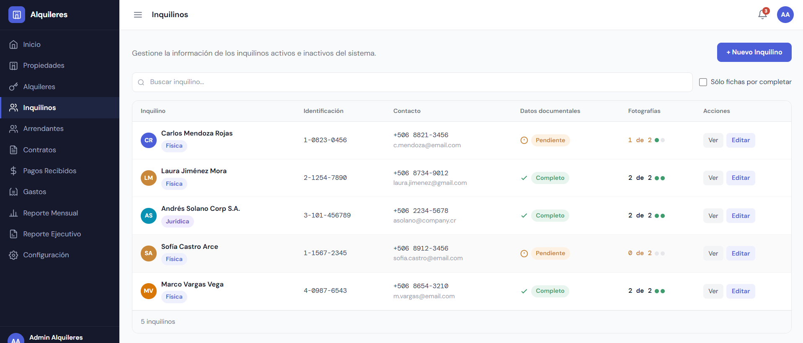
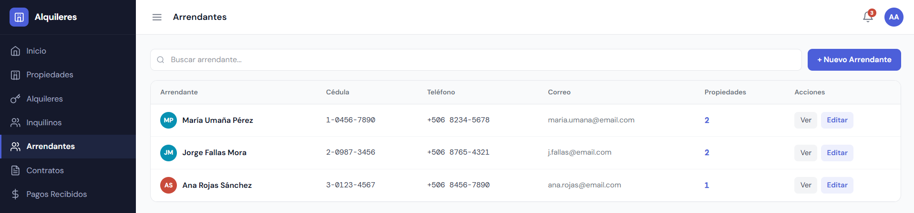
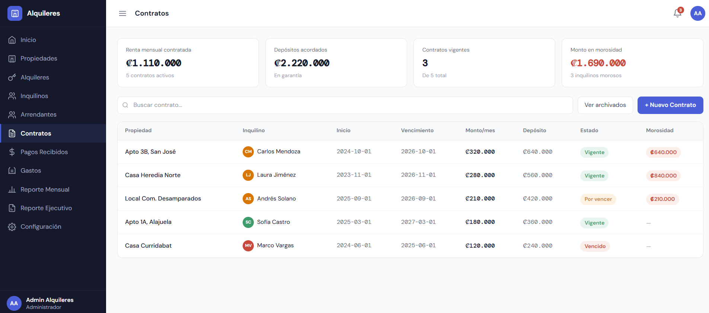

# Sistema de Gestión de Alquileres

Aplicación web para administrar arriendos. Una administradora centraliza toda la operación: **inquilinos, arrendantes, contratos, propiedades, gastos y reporte mensual**.

> Proyecto en equipo (4 personas) · Curso Proyecto de Software, TEC · **En desarrollo**
>
> El código del proyecto es privado por tratarse de trabajo del curso. Este repositorio documenta el sistema y mi participación.

## Mi aporte

Soy responsable de los módulos de **inquilinos**, **arrendantes** y **contratos**:

- **Inquilinos:** listado con búsqueda, distinción entre persona física y jurídica, control del estado de la documentación (completo/pendiente), seguimiento de fotografías requeridas (por ejemplo, 1 de 2) y filtro de "fichas por completar".
- **Arrendantes:** listado con búsqueda, datos de contacto y cantidad de propiedades por arrendante.
- **Contratos:** indicadores (renta mensual contratada, depósitos, contratos vigentes, monto en morosidad), búsqueda, archivo de contratos y estados (vigente, por vencer, vencido).

Trabajamos con **ramas por funcionalidad y pull requests revisados por el equipo**.

## Tecnologías

| Área | Herramientas |
|---|---|
| Frontend | React, Vite |
| Backend | Node.js |
| Datos y autenticación | Supabase, Firebase |
| Control de versiones | Git y GitHub (ramas + pull requests) |

## Capturas

Capturas del dashboard con datos de ejemplo.

### Inquilinos

### Arrendantes

### Contratos

## Equipo

Proyecto académico desarrollado por un equipo de cuatro personas.

## Contacto

Alana Calvo Bolaños · [LinkedIn](https://www.linkedin.com/in/alanacbolanos) · calvoalana@gmail.com

